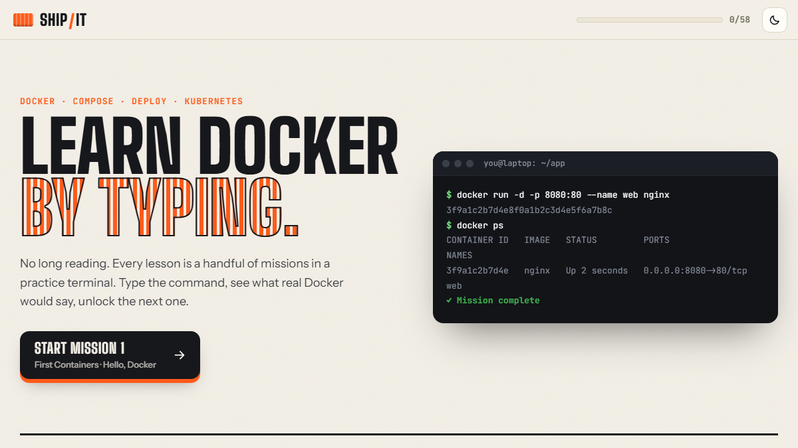
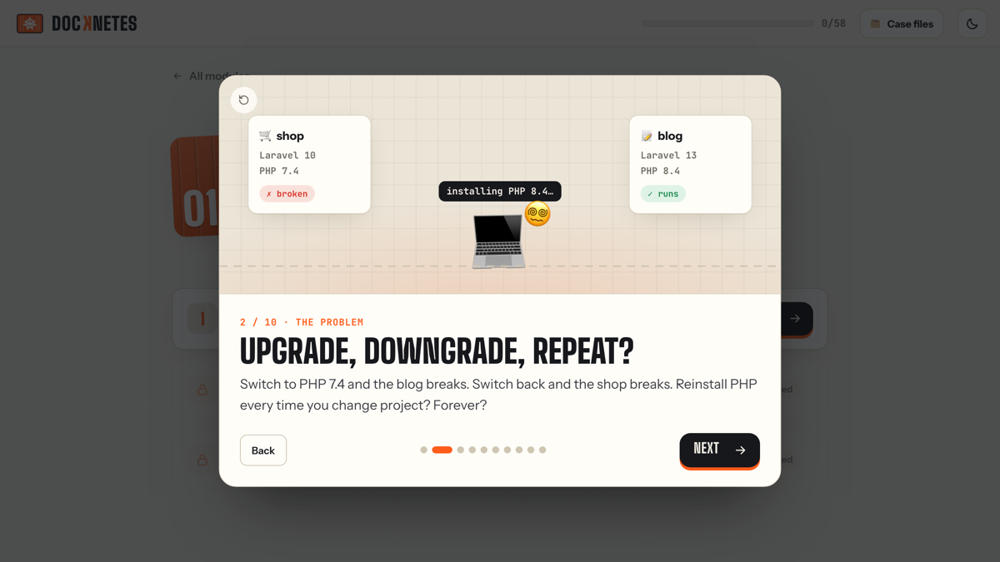
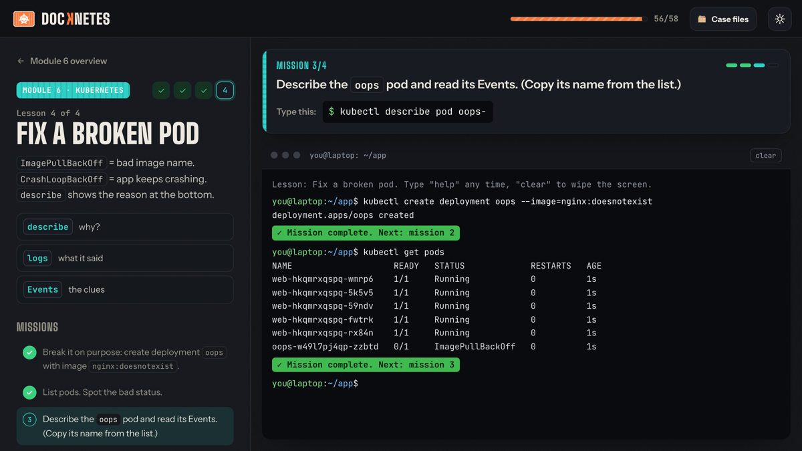

# Ship It: Learn Docker by Typing

**Live: [docker-k8s-learn.vercel.app](https://docker-k8s-learn.vercel.app/)**

A hands-on course for people who'd rather type commands than read docs.
Docker → Compose → deploying to a server → Kubernetes, as **58 missions** in a practice terminal that runs in the browser. No install, no sign-up.



## How it works

- **Learn by typing.** Each lesson is 2 lines of explanation and a few missions. You type real commands into a practice terminal and get the output real Docker would print, errors included.
- **A terminal that remembers.** Run a container and it shows up in `docker ps`. Delete it and it's gone. Works for images, volumes, networks, Compose, `kubectl`, `kind` and `ssh` to a practice server.
- **Checks the result, not the text.** `docker run -d -p 8080:80 --name web nginx` and `docker run --name=web -dp 8080:80 nginx` both pass.
- **Strict order.** Modules, lessons and missions unlock one by one.
- **Guided first run.** The first time through a lesson, the command to type is shown. When you replay a finished lesson it's hidden behind **Hint** and **Show answer**, so you practise from memory.
- **Revisit anything.** Every finished lesson stays open. **Replay missions** runs it again in a fresh sandbox without touching your progress.
- **"Kitchen in a box" intro.** An 8-scene animated story that explains containers, ports, images, volumes, Compose, registries and Kubernetes before mission 1.
- Light (default) and dark themes, works on phones, clean URL, progress saved in the browser (`localStorage`).



## The course

| # | Module | What you do |
|---|---|---|
| 1 | First Containers | run, list, stop, start, remove; ports and logs |
| 2 | Images & Dockerfile | pull, tag, delete images; build and run your own |
| 3 | Volumes & Networks | keep data alive; containers talking by name; clean up |
| 4 | Docker Compose | a whole app from one file; exec, restart, down |
| 5 | Ship to a Server | log in to a registry, push, `ssh` to a VPS, install Docker, deploy |
| 6 | Kubernetes | `kind` cluster, deploy, scale, self-healing, rolling update, rollback, debugging |



## Case files

Real problems, no step-by-step. Open any time, no module needs to be finished first.

Each case is a support ticket plus a broken sandbox. Investigate with the commands from the course, fix it, and the case closes itself (checked after every command). Stuck? Clues unlock one at a time, the last one is the full fix, and every case links to the docs.

| Ticket | Case | Skills |
|---|---|---|
| INC-1041 | The new version won't start | ports, `ps`, `rm` |
| INC-1042 | It's running, but nobody can open it | port mapping, `curl` |
| INC-1043 | The database keeps stopping | `logs`, `-e` |
| INC-1044 | Every deploy deletes our orders | volumes |
| INC-1045 | The API can't reach the database | networks, `logs`, `-e` |
| INC-1046 | Server disk at 97% | `system df`, `prune` (without deleting the backups!) |
| INC-1047 | Friday deploy broke production | `kubectl describe`, `rollout undo` |
| INC-1048 | Black Friday traffic is coming | `kubectl scale`, `expose` |

## Tech

Plain HTML, CSS and JavaScript. No build step, no dependencies, no backend.

| File | What it is |
|---|---|
| `index.html` | Page shell |
| `styles.css` | Theme, layout, intro animations |
| `sim.js` | The fake Docker / Compose / kubectl engine |
| `course.js` | Modules, lessons, missions and their checks |
| `cases.js` | Case studies: ticket, broken setup, check, clues, references |
| `app.js` | UI: home, module overview, lesson + terminal, intro modal |

## Run locally

```bash
python3 -m http.server 5500
```

Open http://localhost:5500

## Add or edit a mission

In `course.js`, each mission is:

```js
{
  goal: "Start nginx ... named <code>web</code>.",
  hint: "docker run -d -p HOST:CONTAINER --name NAME nginx",
  answer: "docker run -d -p 8080:80 --name web nginx",
  check: (r, S) => !!running(S, "web"),   // r = last command result, S = simulator state
}
```

A lesson can also have `setup(S)` to prepare the sandbox (for example, make sure an image exists).

## Deploy

Hosted on Vercel as a static site (framework preset **Other**, no build command, output = repo root). Every push to `main` redeploys.
